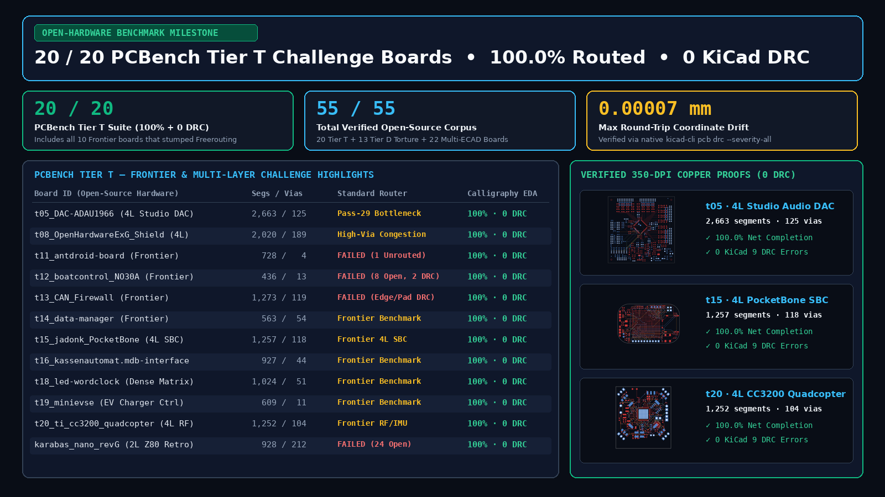
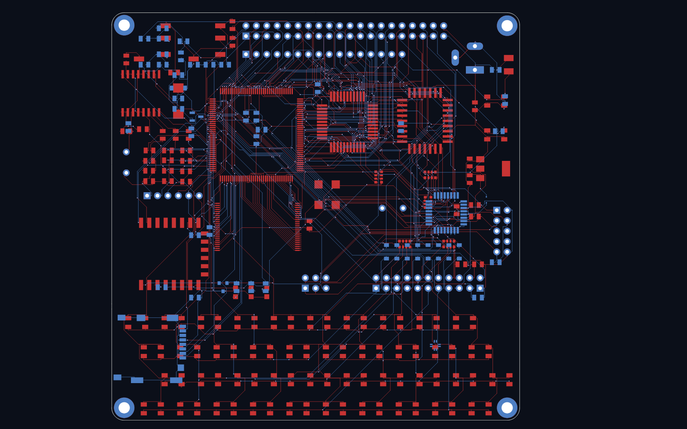
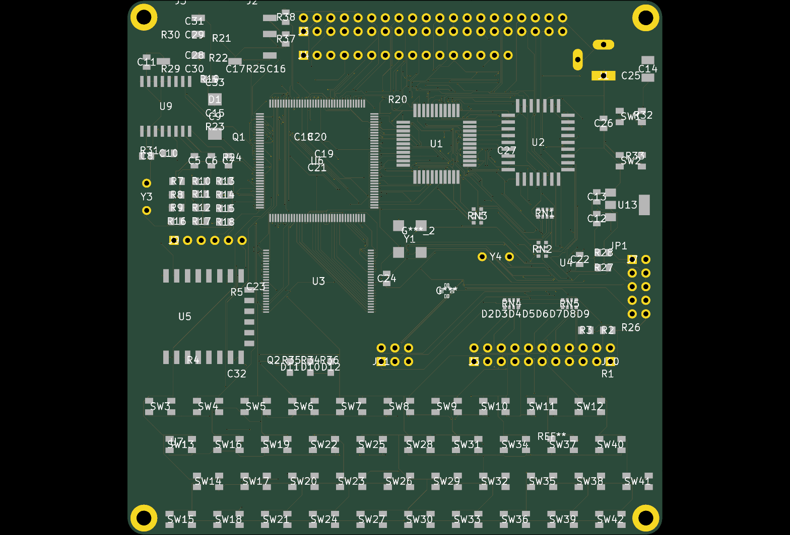
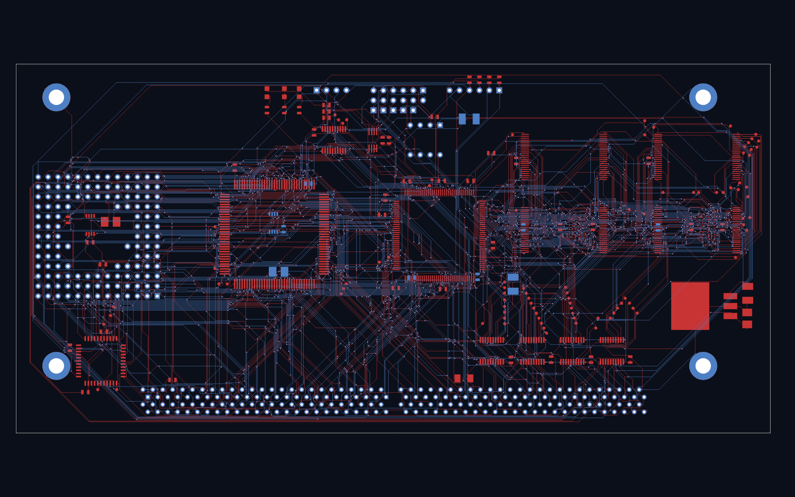
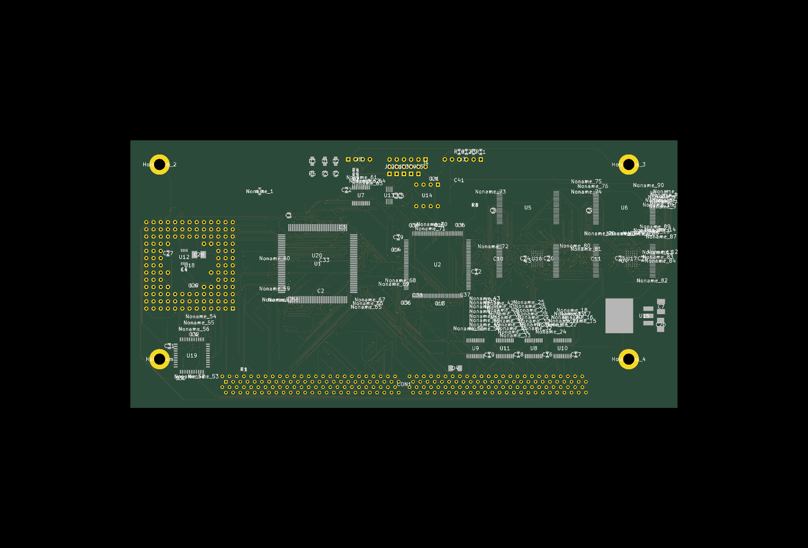
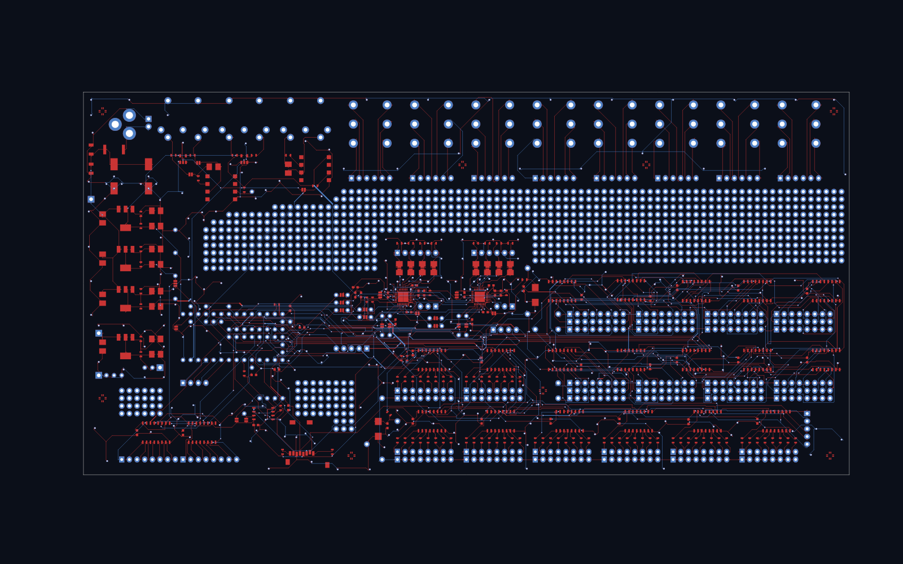
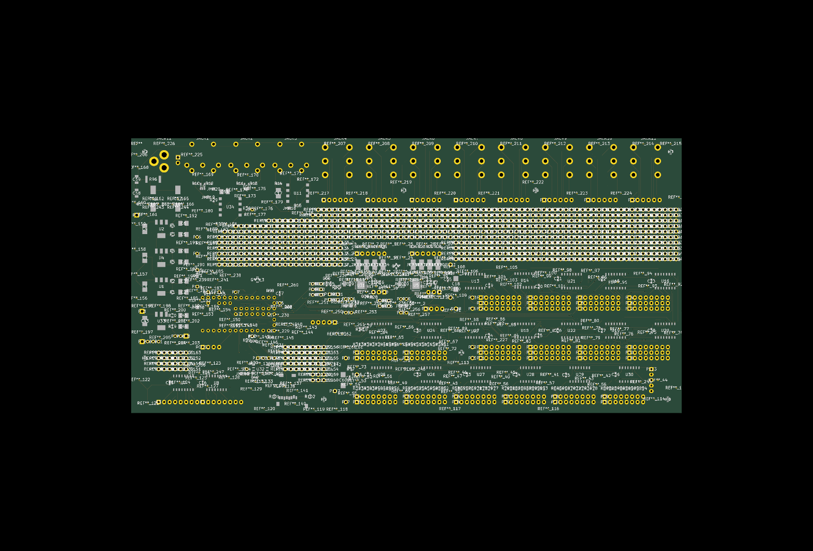

# Vibe-Coding Hardware MCP Server (`vibe-hardware-mcp`)

[](https://mcptry.com/servers/io.github.calligraphysystems/vibe-hardware-mcp)
[](https://glama.ai/mcp/servers/calligraphysystems/vibe-hardware-mcp)

> **A zero-dependency Python 3 Model Context Protocol (`MCP`) server (`calligraphy_mcp_stdio.py`) for local KiCad `.kicad_pcb` & Specctra `.dsn` parsing, PCB transmission-line impedance & IPC-2152 current calculation, local Design-for-Manufacturing (DFM) rule auditing, and multi-layer PCB trace routing.**

---

## Architecture & Included MCP Tools (`calligraphy_mcp_stdio.py`)

This repository contains the complete, zero-dependency Python 3 MCP server implementation in [`calligraphy_mcp_stdio.py`](./calligraphy_mcp_stdio.py) (containerized via [`Dockerfile`](./Dockerfile)):

### 1. Local Offline PCB Analysis, Impedance & DFM Tools (100% Local Execution)
| Tool Name | Execution | Description |
| :--- | :---: | :--- |
| **`analyze_kicad_pcb`** | **Local Python** | Parses `.kicad_pcb` S-expression files locally to extract copper layer stackup (`F.Cu`, `B.Cu`, `In1.Cu`..), board outline dimensions (`Edge.Cuts` in `mm`), footprint count, SMD/THT pad counts, fine-pitch (`<= 0.50 mm`) pad density, netlist count, and routed track/arc/via statistics. |
| **`analyze_specctra_dsn`** | **Local Python** | Parses Specctra `.dsn` autorouter files locally to extract units, resolution, signal/power layers, board boundary dimensions, component pin count, net connectivity, and design rule clearances/widths. |
| **`calculate_pcb_trace_impedance`** | **Local Python** | Closed-form IPC-2141A / Hammerstad-Jensen microstrip & stripline characteristic impedance ($Z_0$), edge-coupled differential pair impedance ($Z_{\text{diff}}$), propagation delay (`ps/mm`), and IPC-2152 DC current capacity / temperature-rise solver. |
| **`audit_pcb_dfm_rules`** | **Local Python** | Audits `.kicad_pcb` and `.dsn` trace widths, clearances, via drill diameters, and annular rings locally against `standard_2l`, `standard_4l`, and `fine_hdi` fabrication limits (JLCPCB / PCBWay). |
| **`calligraphy_list_gallery_boards`** | **Local Python** | Returns the built-in catalog of 13 verified open-source reference PCBs (`100.0%` routed completion, `0` native KiCad copper DRC violations). |

### 2. Optional Cloud Co-Processor Tools (Multi-Layer 3D PCB Routing Offload)
For dense multi-layer boards that require full 3D trace routing, `G1` circular arc smoothing, teardrop pad reinforcement, and turnkey Gerber/Excellon/IPC-D-356 `.ZIP` generation, the server also exposes optional co-processor tools (`calligraphy_preflight_audit`, `calligraphy_compile_board`, `calligraphy_get_job_status`, `calligraphy_download_fab_bundle`, `calligraphy_route_pcb`).

---

## Quick Start (Local `stdio` & Docker)

### Option 1: Run Locally via Python 3 (`stdio` Transport)
No external pip packages are required (uses Python 3.10+ standard library):

```json
{
  "mcpServers": {
    "vibe-hardware-mcp": {
      "command": "python3",
      "args": ["/path/to/vibe-hardware-mcp/calligraphy_mcp_stdio.py"]
    }
  }
}
```

### Option 2: Run via Docker (`Dockerfile`)
```bash
docker build -t vibe-hardware-mcp .
docker run -i --rm vibe-hardware-mcp
```

### Option 3: Remote Streamable-HTTP Endpoint (Claude Code / Cursor)
```bash
claude mcp add --transport http calligraphy-eda https://calligraphyeda.com/api/v1/mcp
```

---

## Visual Proof: `55 / 55` Verified Open-Source Benchmark Sweep (`20 / 20` `PCBench Tier T` + `13 / 13` `Tier D` + `22 / 22` Multi-ECAD at `100.0%` Completion & `0` Native KiCad 9 DRC)



> **Full 20-Board `PCBench Tier T` & 13-Board `Tier D` Scoreboard:** [github.com/calligraphysystems/open-pcb-routing-benchmark](https://github.com/calligraphysystems/open-pcb-routing-benchmark)

| Benchmark Board | 350-DPI Routed Copper Proof (`0` DRC) | 3D Raytraced Assembly Render |
| :--- | :---: | :---: |
| **`Karabas-Nano` (2-Layer, `738` Pads, `928` Connections)**<br>`100.0%` Completion • `0` Unconnected • `0` KiCad DRC |  |  |
| **`Decelerator4030` (`908` Pads, `487` Connections, Off-Axis `45°` `LQFP-100`)**<br>`100.0%` Completion • `0` Unconnected • `0` KiCad DRC |  |  |
| **`Teensy MCU Breakout` (High-Density Through-Hole + SMD)**<br>`100.0%` Completion • `0` Unconnected • `0` KiCad DRC |  |  |

---

## License

MIT License — Copyright (c) 2026 **Calligraphy Systems LLC** ([https://calligraphyeda.com](https://calligraphyeda.com)).
